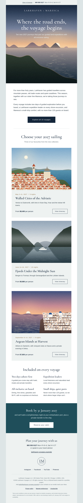
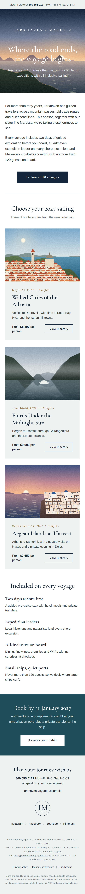
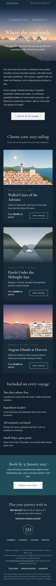

# Larkhaven × Maresca: HTML email template

A responsive promotional email for a fictional luxury travel brand (land expeditions × small-ship cruises). Brand, copy, logo and illustrations are invented for this portfolio project.

**Live preview:** add your GitHub Pages link here

| Desktop | Mobile | Mobile, dark mode |
|---|---|---|
|  |  |  |

## What's inside
- Table-based layout, 600px container, inline CSS
- Background-image hero with VML fallback for Outlook (Windows)
- Bulletproof buttons (VML for Outlook, HTML elsewhere)
- Mobile layout via media queries: fluid images, stacked columns, adjusted type
- Dark mode support (`prefers-color-scheme`, Outlook `data-ogsc`), with a swapped logo
- Hidden preheader text, `alt` text on all images, `role="presentation"` tables
- Web font (Cormorant Garamond) with Georgia fallback

## Before sending a real test
Email clients need absolute image URLs. Upload the `images/` folder (e.g. to GitHub Pages) and replace every `images/` path with the full URL, such as `https://username.github.io/larkhaven-email/images/hero.jpg`.

## Tested in
_Fill in after testing: Gmail (web, iOS), Apple Mail, Outlook…_
